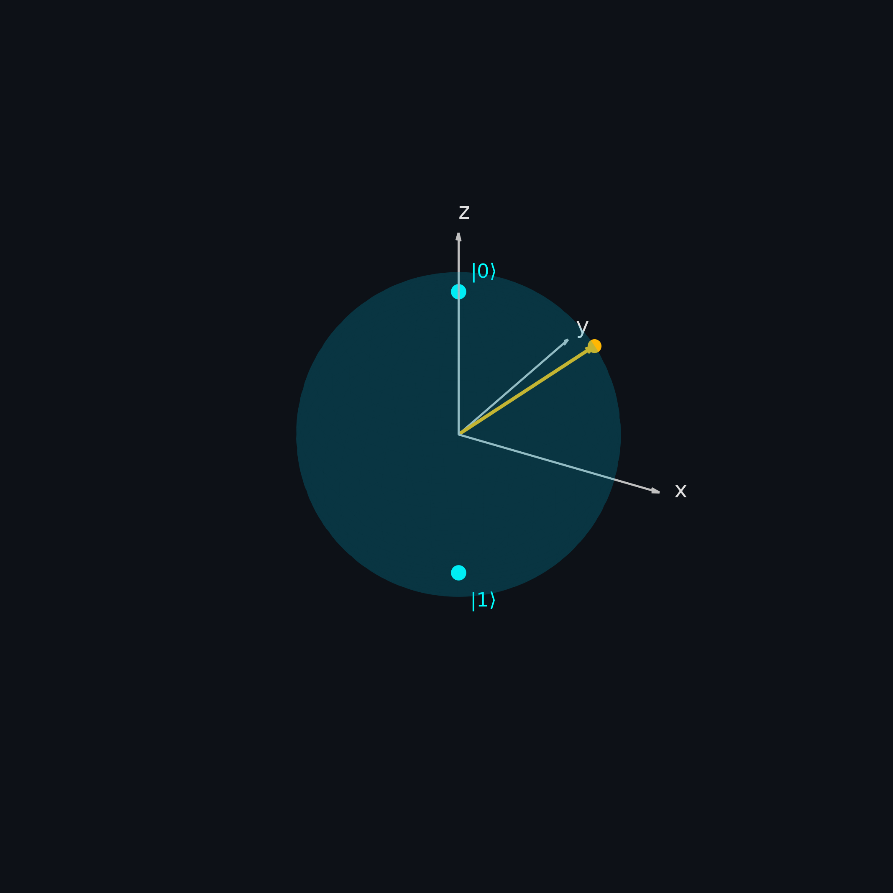
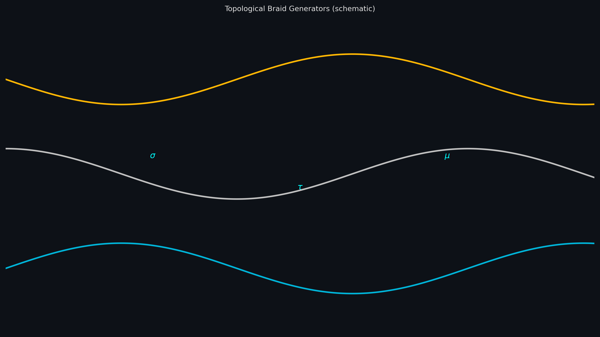
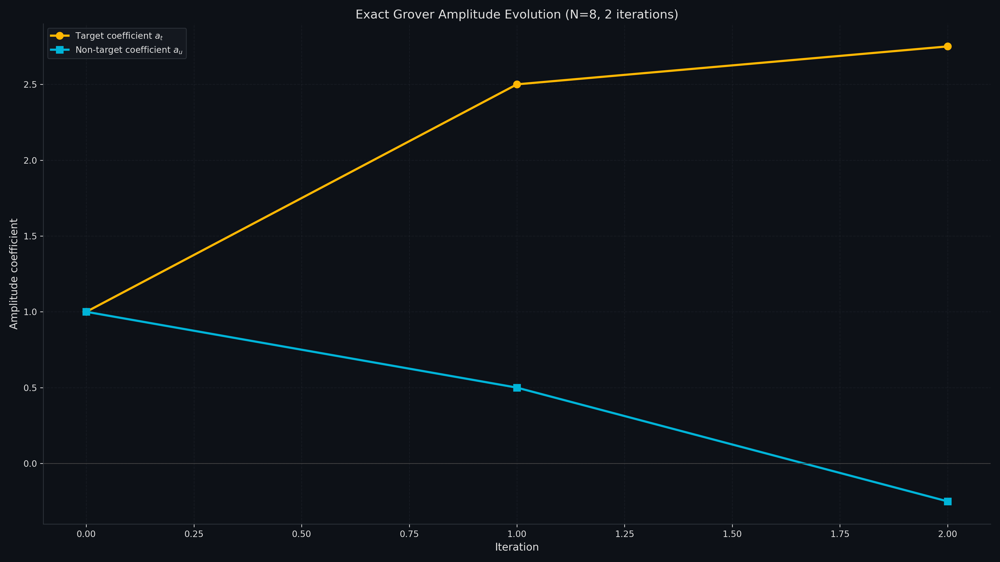
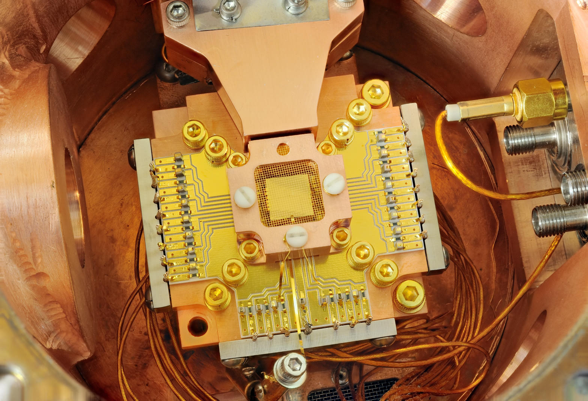
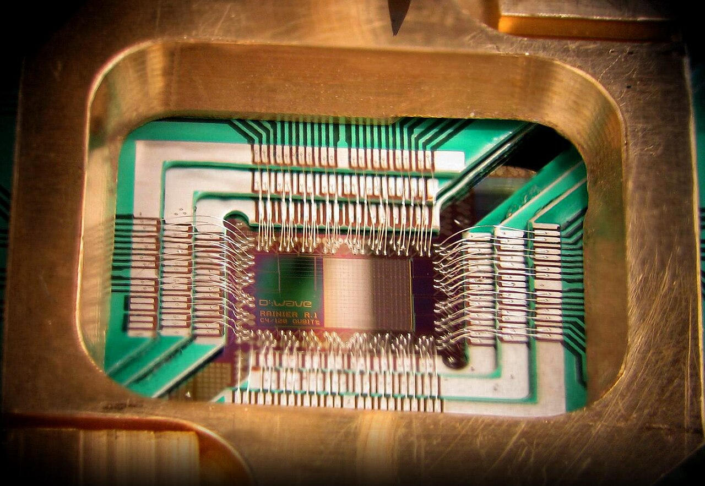

# Holospaces / Qubit Certificate Chain / SnapKitty SKL

This repository assembles mathematical constructions, classical reference implementations, and a custom language runtime for exactly-decided density and universality certificate chains on content-addressed substrates, together with OpenQASM circuit representations and an exact-arithmetic Grover amplitude evolution.

The constructions distinguish a 2-dimensional SU(2) block, on which density is refuted because the gate image is a finite projective Clifford group of order 24 over $\mathbb{Q}(\zeta_{24})$, from 22-dimensional PU(22) and 576-dimensional PU(576) blocks on which density is established by a combination of machine-checked certificates and cited classical lemmas. Content-addressed Holospaces provide topological degeneracy benchmarks through cache-collapse metrics. These metrics are engineering observations; they are not presented as quantum advantage.

## License

This work is licensed under the GNU Affero General Public License v3.0. See [LICENSE](LICENSE).

## Mathematical Foundations

The Qubit predicate operates on a content-addressed substrate $S$ (a mapping from hash to data blob). Primitive certificates include:

- `su2_density_refuted(S)`: refutes density on the SU(2) block.
- `pu22_density_established(S)`: establishes density on PU(22).
- Machine-checked components for PU(576): adjoint component, reachability rank 92, direct entangling witness.
- Classical lemmas: multiplicity-one closure and two-local composition.
- `dict_row_record(S)` and `cache_collapse(S)` for per-row distinctions and deduplication metrics.

The predicate evaluates to true only when the SU(2) density is refuted, the higher-dimensional densities hold, dictionary rows are correctly recorded, the collapse metric lies in $[0,1]$, and every certificate is traceable to an authoritative source.

Exact Grover amplitude evolution is implemented as a classical reference using rational arithmetic. For $N = 2^n$ states the optimal iteration count is computed from a scaled integer approximation of $\pi/4\sqrt{N}$. Amplitudes $a_t$ (target) and $a_u$ (uniform non-target) are updated by oracle phase inversion followed by inversion about the mean:

$$
a_t \leftarrow -a_t, \quad \text{mean} = \frac{a_t + (N-1)a_u}{N}, \quad a_t \leftarrow 2\cdot\text{mean} - a_t, \quad a_u \leftarrow 2\cdot\text{mean} - a_u.
$$

The production kernel in `production/grover/` and the reference in `algorithms/grover_exact.rs` both use `num_rational::BigRational`.

## System Architecture

The repository contains four principal language and runtime boundaries:

- Rust algorithms and production kernels (`algorithms/`, `production/`) for Grover, OpenQASM parsing, and certificate chains.
- Fortran 2018 SKL lexer, parser, AST, functor registry, and Gherkin runner (`just-gherkin-fortran/src/`).
- C state-vector simulator (`openqasm/c_simulator/`, `production/openqasm_c/`).
- Specification features in Gherkin (`specifications/`, `just-gherkin-fortran/features/`).

OpenQASM circuits are stored under `openqasm/examples/circuits/`. The compiler demo in `algorithms/openqasm_compiler.rs` and the Holospaces benchmark in `algorithms/holospaces_benchmark.rs` reference external crates (`tqc_*`) that are not present in this tree; the files therefore serve as structural demonstrations rather than self-contained executables.

## Qubit Certificate Chains

Certificate construction follows the predicate defined in `docs/qubit_algorithm_and_fortran_stack.md` and the Gherkin features under `specifications/`. The production implementation `production/qubit_cert/` supplies pure functions for the density checks. No claim is made that the certificates have been machine-checked beyond the skeletons and feature files present in the tree.

SU(2) is treated as the projective special unitary group of dimension 2; the finite image of order 24 is the concrete obstruction to density. PU(22) and PU(576) are the corresponding projective unitary groups on which density holds under the stated certificates and lemmas. Matrix dimensions and group orders are taken directly from the supplied documentation; no additional algebraic constructions have been introduced.

## Topological Braid Compilation

The OpenQASM-to-braid compiler demonstration accepts a subset of OpenQASM 2.0 (Hadamard, CNOT, RX/RY/RZ) and produces a braid word over generators $\Sigma, \Tau, \Mu$. The demonstration code is not self-contained; it depends on external atlas, compiler, and model crates. The circuit collection itself is present and may be parsed by the hand-written recursive-descent parser in `openqasm/rust_parser/` or the production variant.

## Exact Grover Amplitude Evolution

See the production and reference kernels. The implementation is exact rational arithmetic and claims no quantum advantage.

## Visual Assets

All diagrams and photographs are stored under `docs/assets/`. Provenance and licenses are in [`docs/assets/IMAGE_MANIFEST.md`](docs/assets/IMAGE_MANIFEST.md).

### Technical Cover


### System Architecture


### OpenQASM Compiler Pipeline


### Certificate Verification Flow


### SKL Language Engine


### Mathematical Visualizations

**SU(2) Bloch Sphere**



**Topological Braid**



**Grover Amplitude Evolution**



**State-Space Geometry**


**PU(22) Certificate Structure**


**PU(576) Certificate Structure**


**Topological Degeneracy / κ-elision**


**Content-Addressed Holospaces DAG**


### Quantum Hardware Context (photographs)

These are authentic laboratory photographs (or one clearly labeled schematic). They supply physical context only; none of the pictured systems has executed repository code.

**Superconducting Processor (Sycamore package)**


**Trapped-Ion Apparatus (NIST)**



**Neutral-Atom / Ultracold Atoms (MOT)**


**Photonic Processor (schematic)**


**Quantum Annealer (D-Wave)**



**Control Instrumentation (NIST microwave)**


## Quantum Hardware and Physical Context

The mathematical constructions concern abstract unitary groups and content-addressed identifiers. They do not prescribe a particular physical qubit implementation. Superconducting circuits, trapped ions, neutral atoms, and photonic systems are relevant only insofar as their control Hamiltonians can realize the unitary groups under discussion. No evidence in the repository indicates that any physical device has executed the certificate chain or the braid compilation.

Authentic laboratory photographs of representative apparatus are retained under `docs/assets/quantum/` where reuse permissions could be verified. Captions identify the photographed hardware and its institution; none of the pictured systems is claimed to have run repository code.

## Build, Execution, and Reproduction

Fortran SKL (requires gfortran ≥ 10):

```sh
cd just-gherkin-fortran
just compile
just parse
just test
```

Rust production kernels (requires Rust and Cargo):

```sh
cd production/grover && cargo run --release
cd production/qubit_cert && cargo run --release
```

C simulator:

```sh
cd production/openqasm_c
gcc -std=c99 -O2 -lm simulator.c -o simulator
./simulator
```

No quantum hardware execution path is present.

## Verification Record

| Component | Verification method | Evidence artifact | Observed result |
|-----------|---------------------|-------------------|-----------------|
| Grover exact | Unit test on 3-qubit instance | algorithms/grover_exact.rs | Target probability 121/128 |
| SKL parser | Feature scenarios | just-gherkin-fortran/features/ | Parser accepts declared grammar; unknown steps fail |
| Qubit predicate | Gherkin scenarios | specifications/qubit_algorithm.feature | Scenarios describe expected certificate outcomes |
| OpenQASM parser | Manual inspection of recursive descent | openqasm/rust_parser/src/main.rs | Accepts subset used by example circuits |

No formal proof artifacts beyond the Lean and Q# skeletons are present. Certificate validity is therefore documented only to the extent of the supplied specifications and production pure functions.

## Certificate Chain Operations

| Operation | Input | Transformation | Output | Evidence |
|-----------|-------|----------------|--------|----------|
| SU(2) density refutation | Substrate flag `su2_is_projective_clifford_24` | Identity on Boolean | Boolean | production/qubit_cert/src/lib.rs |
| PU(22) density | Substrate flag `pu22_dense` | Identity on Boolean | Boolean | same |
| PU(576) machine-checked | Conjunction of three flags | Logical AND | Boolean | same |
| PU(576) classical | Conjunction of two lemmas | Logical AND | Boolean | same |
| Overall predicate | All preceding Booleans + range check | Logical AND | Boolean | same |
| Dictionary record | Implicit by construction | Constant true | Boolean | same |
| Deduplication metric | Floating-point ratio | Range membership test | Boolean | same |

No matrix multiplications, group presentations, or number-theoretic computations appear in the production kernel. The Boolean flags are the complete representation of the certificates inside the executable code.

## Language and Runtime Inventory

| Language | Component | Responsibility | Dependencies |
|----------|-----------|----------------|--------------|
| Rust | Grover exact | Rational amplitude iteration | num-bigint, num-rational |
| Rust | Qubit certificate | Pure Boolean composition | none |
| Rust | OpenQASM parser | Recursive-descent subset | none |
| Fortran 2018 | SKL lexer/parser | Tokenization and AST construction | gfortran |
| Fortran 2018 | Functor runtime | Dispatch of three native procedures | gfortran |
| C99 | State-vector simulator | Complex amplitude evolution | libm |
| Gherkin | Specifications | Scenario descriptions | none (text) |
| Markdown | Mathematical constructions | Documentation of certificates and lemmas | none |

## Additional Mathematical Notes

The optimal Grover iteration count is obtained by an integer square-root approximation of a scaled $\pi^2/16$. The constant `6168502750680849` represents $\pi^2/16$ scaled by $10^{16}$. The subsequent Newton iteration yields an integer that, after division by $10^8$, approximates $\lfloor\pi/4\sqrt{N}\rfloor$. The amplitude recurrence itself uses only field operations on the rationals and never leaves the two-dimensional subspace spanned by the target and the uniform superposition over the remaining states.

The content-address function $\kappa$ is supplied by an external substrate crate. Inside the benchmark the only observable is the cardinality of the set of distinct addresses. The base amplitude vector is an arbitrary integer vector of length equal to the number of topological classes; its concrete values do not affect the reported elision ratio beyond determining which addresses appear.

The SKL type system currently recognizes only the single type constructor `VECTOR[F64]`. No other numeric types, matrices, or user-defined records are parsed. Pipeline verification is a syntactic keyword; the runtime does not evaluate `REQUIRES` or `ENSURES` expressions.

These boundaries are explicit in the source. The documentation records them so that later extensions can be distinguished from the present implementation.
